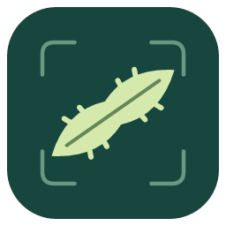

<p align="center">
  
</p>
<h1 align="center">Sclerite Studio</h1>
<p align="center">An offline microscopy workspace for sclerite segmentation, measurement and classification.</p>
<p align="center"><strong>Source 0.13.0 · 中文 / English · Windows / macOS</strong></p>
<p align="center"><a href="README.md">简体中文</a> · <strong>English</strong></p>
<p align="center">
  <a href="https://github.com/GUIBA-EX/sclerite_studio/releases/download/v0.12.3/Sclerite-Studio-0.12.3-bilingual-DINOv3-mac-arm64.zip"><strong>Download for Mac</strong></a> ·
  <a href="https://github.com/GUIBA-EX/sclerite_studio/releases/download/v0.12.3/Sclerite-Studio-0.12.3-Windows-x64-portable.zip"><strong>Download for Windows</strong></a> ·
  <a href="https://github.com/GUIBA-EX/sclerite_studio/releases/tag/v0.12.3">Release notes & SHA-256</a>
</p>
<p align="center">Current downloads: 0.12.3; 0.13.0 application packages are not yet released.</p>
<p align="center">Mac: Apple Silicon · macOS 14+ | Windows: x64 · WebView2 and Visual C++ runtime required</p>

---

## Overview

Sclerite Studio brings octocoral light-micrograph segmentation, completeness review, morphometrics, classification and plate layout into one offline desktop workspace. It starts in Chinese; choose **English** at the top right. Your choice is remembered locally without changing images, masks, approvals, layouts or user-authored labels.

### Features

- **Image processing:** PNG, JPEG and single-page TIFF; background correction, threshold segmentation, touching-group splitting, brush/eraser corrections, merging and undo.
- **Completeness review:** approve individual objects or batches before exporting results. Occluded outlines are never reconstructed; automatic splits still require review.
- **Calibrated measurements:** preserve original images and measure length, width, area, aspect ratio and circularity. Length is 2D maximum Feret diameter, not arc length.
- **Classification:** manual classes and specimen labels → frozen features → lightweight logistic regression → batch prediction and review. MobileNetV4 is the default; authorized builds also support DINOv3 ViT-S/16.
- **Grouped evaluation:** check recorded relationships among specimens, colonies, publications and duplicate originals instead of randomly splitting individual sclerites. Trial models do not provide independent validation.
- **Plate layout:** preserve relative sizes, align along the long axis and move, rotate or scale individual objects. Supports multiple photos/pages, multi-selection, black/white backgrounds, source notes and scale bars.
- **Local projects:** save originals, masks, approvals, labels and editable layouts; recover local work and export CSV, crops, masks and PNG plates. The 0.13.0 source adds incremental recovery and compressed undo history. Photos are not uploaded.

### Quick start

1. Import micrographs, enter specimen/tissue information and check scale calibration.
2. Segment, correct touching groups or outlines, and approve intact objects.
3. Export measurements or organize labels, train and review in Classification.
4. Combine multiple views in Plate layout, adjust the arrangement and export.

**Windows portable:** extract the complete folder and run the executable. Keep accompanying runtime files beside it. Requires x64 Windows, Microsoft Edge WebView2 and the Visual C++ x64 runtime. See the [portable guide](docs/WINDOWS-PORTABLE.md). This build has not been tested on Windows hardware.

**macOS:** Apple Silicon and macOS 14+. The local package is ad-hoc signed, not Apple-notarized.

### Scientific scope and licensing

Software tests are not biological accuracy validation. Model scores are not true species probabilities; a sclerite is not an independent specimen, and classification is not species delimitation. Researchers must check tissues, batches, sources and label reliability. Uncalibrated objects cannot support absolute-size comparisons.

The source repository contains code, icons, tests, model metadata and license notices—not research photos, user projects, caches or weight files. Consult each release package for its included models and licenses; use and redistribution remain subject to their terms. Obtain authorized Meta weights when building DINOv3 yourself. Third-party notices are in [models](src-tauri/models/) and [runtime](src-tauri/runtime/). No additional, undeclared open-source license is granted for this repository.

## Development

Frontend: **React · TypeScript · Vite**. Desktop: **Tauri 2 · Rust**. Inference: **ONNX Runtime**, CPU on Windows; MobileNet Core ML CPU/GPU is experimental on Mac. DINOv3 uses CPU. NPU is not enabled.

```sh
npm ci
npm test
npm run dev
```

The browser supports image processing, layout and label organization. Native training and prediction require a desktop build. Frontend tests do not require model weights.

### Prepare models before a desktop build

The desktop embeds `src-tauri/models/encoder.onnx`, which is deliberately excluded from Git. Run `node scripts/fetch-encoder.mjs` before building to download and verify the pinned model from [models-v1](https://github.com/GUIBA-EX/sclerite_studio/releases/tag/models-v1). Set `SCLERITE_ENCODER_URL` to use a mirror. Use a separate Python environment only when developing or validating an encoder:

```sh
python -m venv .venv
# Activate the environment using the command for your operating system.
python -m pip install -r requirements-export.txt
python scripts/export_encoder.py --verify-only
```

Verification compares the existing ONNX and PyTorch outputs and updates the verification metadata. Omit `--verify-only` to export a new encoder; the script refuses to overwrite an existing one. A new export may have a different hash and affect cache or model compatibility. Python is a development dependency, not an end-user requirement.

```sh
# Windows portable build, with Rust MSVC and C++ build tools installed:
npm run build
cargo build --release --locked --manifest-path src-tauri/Cargo.toml
node scripts/package-windows.mjs

# macOS, after preparing ONNX Runtime 1.24.2 in src-tauri/runtime:
npm run desktop:build -- --config src-tauri/tauri.macos.conf.json --bundles app
```

DINOv3 builds require an authorized checkpoint, its license and validation metadata from `scripts/export_dinov3.py`; then add `--features dinov3`. Never commit signed download URLs or personal authorization messages. See [development history](docs/DEVELOPMENT.md) and [verification notes](VERIFICATION.md). Historical local artifact paths in those notes are not repository downloads.

Browser smoke tests use locally supplied microscopy data. Set `SCLERITE_TEST_DATA` to your MR0145 folder where required. For segmentation evaluation, set `SCLERITE_EVAL_DATA` to a folder of manually annotated project ZIPs and run `npm run eval:seg`; see the [evaluation guide](docs/EVALUATION.md) for ground-truth and metric definitions. This is separate from `npm test`; a real-data baseline remains to be established.

## Repository layout

```text
src/                 Interface, segmentation, measurements and layout
src-tauri/src/       Native inference, model validation and training
src-tauri/models/    Model metadata and license notices (no weights)
src-tauri/icons/     Application logo and platform icons
scripts/            Development-only model export and verification
tests/              Unit tests and local browser workflows
docs/               Development and operating guides
```
